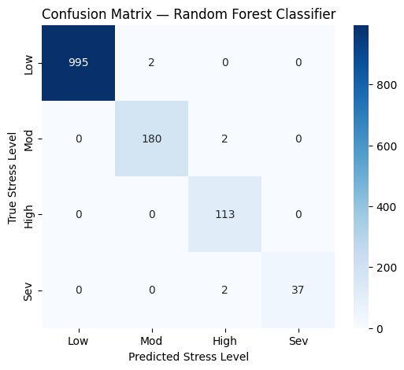
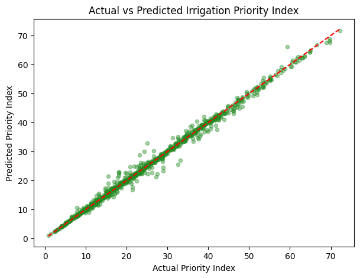
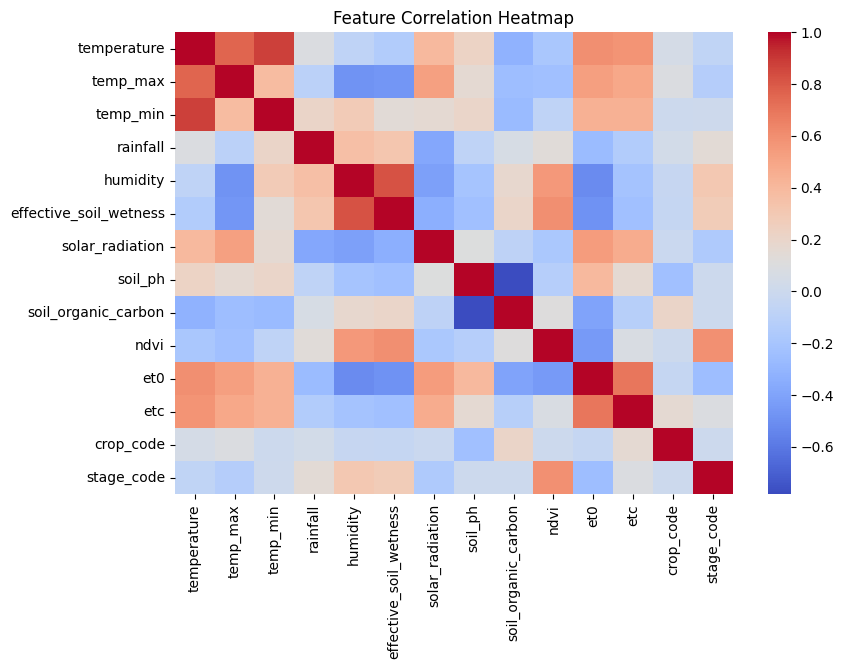
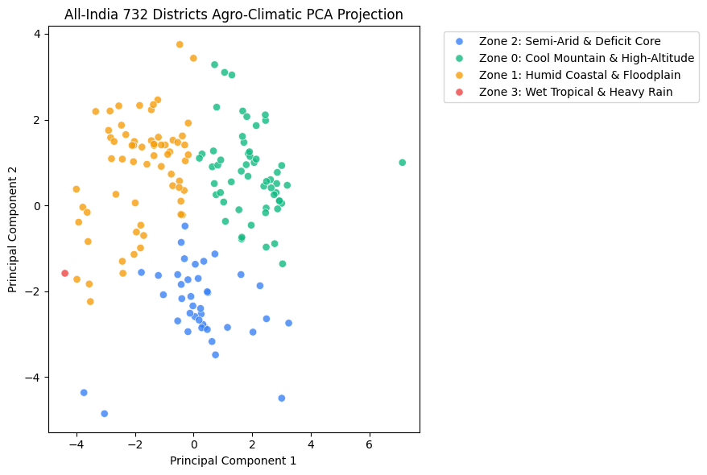

# KrishiJal: All-India Crop Stress & Irrigation Priority Decision Support System

[](https://www.python.org/)
[](https://fastapi.tiangolo.com/)
[](https://scikit-learn.org/)
[](https://www.mysql.com/)
[](https://www.kaggle.com/code/ruthvikpasupunuri/crop-stress-and-irrigation-priority-decision-suppo)

**KrishiJal** is an end-to-end **Agricultural Intelligence and Decision Support System** built for KMIT academic submission. It unifies satellite/meteorological agro-climatic data, trained Scikit-Learn ML models, a MySQL 8.0 relational database, and a unified 6-module Leaflet + FastAPI portal covering Indian States & Union Territories.

---

## Live Demo & Kaggle Single Source of Truth

- **GitHub Repository:** https://github.com/ruthvik-08/SDC-project
- **Deployed Portal (Render):** https://crop-stress-and-irrigation-priority.onrender.com/app/
- **Kaggle Training Notebook (Version 5):** https://www.kaggle.com/code/ruthvikpasupunuri/crop-stress-and-irrigation-priority-decision-suppo

All website ML metrics in [backend/model_evaluation_metrics.json](backend/model_evaluation_metrics.json) and saved `.pkl` weights in [models/saved_models/](models/saved_models/) are directly synchronized with [notebooks/krishijal_complete_pipeline.ipynb](notebooks/krishijal_complete_pipeline.ipynb) (Kaggle Version 5).

---

## Six Integrated Dashboard Modules

Every page of [frontend/index.html](frontend/index.html) shares consistent navigation across all 6 modules via the top sticky bar, home shortcut buttons, feature cards, and per-view quick-switch dock:

| # | Module | Route | Capability |
| :-: | :--- | :--- | :--- |
| 1 | **Geospatial Map** | `#/map` | Interactive Leaflet choropleth with Clean/Satellite basemaps, highlighted State borders, 732+ district drilldowns, soil health, and seasonal profiles |
| 2 | **Predictor** | `#/predictor` | Live 14-feature control station predicting Stress Level (`Low`–`Severe`), Irrigation Priority Index (`0–100`), daily water deficit, and farmer advisory |
| 3 | **Irrigation Priority** | `#/ranking` | Ranked district priority queue sorted descending by urgency score with crop/soil water deficit breakdown |
| 4 | **ML Benchmarks** | `#/benchmarks` | Dynamic benchmark dashboard displaying actual Kaggle Version 5 classifier & regressor metrics plus Random Forest confusion matrix |
| 5 | **Agro-Climatic Clusters** | `#/clusters` | K-Means (`k=4`) and 2D PCA zone segmentation grouping districts into homogeneous water-management zones |
| 6 | **Farmer Records** | `#/farmers` | Full MySQL CRUD portal (`Create`, `Read`, `Update`, `Delete`) linked to prediction history and one-click loading into Predictor |

---

## Kaggle Version 5 Machine Learning Evaluation

Dataset pipeline in [notebooks/krishijal_complete_pipeline.ipynb](notebooks/krishijal_complete_pipeline.ipynb):
- Master dataset ([data/processed/krishijal_master_dataset.csv](data/processed/krishijal_master_dataset.csv)): **7,386 total rows × 72 columns** (`4,758` daily + `1,896` monthly + `732` district baselines) covering **10 crops** and **4 growth stages**.
- Training/Test modeling subset: **6,654 daily/monthly observations** across 159 sampled stations, stratified 80/20 split (**5,323 train / 1,331 test**) scaled with `StandardScaler` (`14` agronomic features).

### 1. Crop Stress Classification (4 Classes: Low, Moderate, High, Severe)

| Algorithm | Hyperparameters | Accuracy | Precision | Recall | F1-Score | Status |
| :--- | :--- | :---: | :---: | :---: | :---: | :--- |
| **Random Forest Classifier** | `n_estimators=100, max_depth=12` (GridSearchCV cv=3) | **99.55%** | **99.56%** | **99.55%** | **99.55%** | **Best Overall** (`.pkl`) |
| **Decision Tree Classifier** | `max_depth=8` | 99.47% | 99.48% | 99.47% | 99.47% | Comparison Model |
| **Logistic Regression** | `max_iter=1000` | 96.02% | 96.06% | 96.02% | 96.03% | Linear Baseline |

**Random Forest Confusion Matrix (1,331 Test Samples):**
```text
Actual \ Pred |  Low | Moderate | High | Severe
--------------+------+----------+------+-------
Low           |  995 |        2 |    0 |      0
Moderate      |    0 |      180 |    2 |      0
High          |    0 |        0 |  113 |      0
Severe        |    0 |        0 |    2 |     37
```

### 2. Irrigation Priority Index Regression (Continuous Score `0–100`)

| Algorithm | Hyperparameters | MAE | MSE | RMSE | R² Score | Status |
| :--- | :--- | :---: | :---: | :---: | :---: | :--- |
| **Random Forest Regressor** | `n_estimators=100, max_depth=12` | **0.4538** | **0.9127** | **0.9554** | **0.9952** | **Best Regressor** (`.pkl`) |
| **Decision Tree Regressor** | `max_depth=8` | 1.1975 | 4.0257 | 2.0064 | 0.9789 | Non-Linear Comparison |
| **Linear Regression** | Default OLS | 4.8669 | 37.1909 | 6.0984 | 0.8055 | Linear Baseline |

### Verified Output Plots (Extracted from Kaggle Version 5)

| Confusion Matrix (RF) | Actual vs Predicted (RF Regressor) |
| :---: | :---: |
|  |  |

| Feature Correlation Heatmap | PCA 2D Agro-Climatic Clusters |
| :---: | :---: |
|  |  |

---

## Clean Project Structure

```text
SDC-project/
├── backend/
│   ├── main.py                           # FastAPI API server, ML inference & MySQL CRUD routes
│   ├── model_evaluation_metrics.json     # Kaggle Version 5 evaluation metrics & confusion matrix
│   ├── data -> ../data                   # Symlink for Uvicorn working directory safety
│   ├── frontend -> ../frontend
│   └── models -> ../models
├── data/
│   ├── build_portal_data.py              # Aggregates dataset into frontend/data/portal_data.json
│   └── processed/
│       └── krishijal_master_dataset.csv  # Unified 7,386-row × 72-col dataset
├── database/
│   └── crop_stress_db.sql                # Normalized 6-table MySQL schema
├── docs/
│   ├── KrishiJal_Complete_Project_Explanation.md  # Detailed academic walkthrough (13 sections + Viva Q&A)
│   └── figures/                          # 8 authentic PNG visualizations from Kaggle Version 5
├── frontend/
│   ├── index.html                        # 6-module Single Page Application
│   ├── portal.css                        # Responsive portal design system
│   ├── portal.js                         # Map, Predictor, Priority, Benchmarks, Clusters & CRUD logic
│   └── data/
│       ├── india_districts_simplified.geojson
│       ├── india_states_simplified.geojson
│       └── portal_data.json
├── models/
│   └── saved_models/
│       ├── crop_stress_classifier.pkl    # Tuned Random Forest Classifier
│       ├── irrigation_priority_regressor.pkl # Random Forest Regressor
│       ├── feature_scaler.pkl            # StandardScaler fitted on 5,323 train rows
│       ├── crop_stress_decision_tree.pkl
│       ├── crop_stress_logistic_regression.pkl
│       ├── irrigation_decision_tree.pkl
│       ├── irrigation_linear_regression.pkl
│       └── model_metadata.json
├── notebooks/
│   └── krishijal_complete_pipeline.ipynb # Synced Kaggle Version 5 notebook (35 cells + outputs)
├── postman/
│   └── KrishiJal_Postman_Collection.json # Updated Postman suite (ML + Analytics + MySQL CRUD)
├── tests/
│   └── test_project.py                   # 8-stage automated verification suite
├── main.py -> backend/main.py            # Root entry symlink for Render / Uvicorn
├── run_local.py                          # Local server launcher
├── render.yaml                           # Render deployment configuration
├── requirements.txt                      # Runtime backend & MySQL dependencies
├── requirements-notebook.txt             # Optional offline Jupyter plotting dependencies
├── .env.example                          # Template MySQL environment configuration
└── .gitignore                            # Protects .env, OS & Python/Jupyter caches
```

---

## Quickstart (Local Mac / Linux / Windows)

```bash
# 1. Install dependencies
pip install -r requirements.txt

# 2. Initialize MySQL schema & create .env from .env.example
mysql -u root -p < database/crop_stress_db.sql
cp .env.example .env   # Fill in your MYSQL_PASSWORD locally

# 3. Start backend & portal
python3 run_local.py
```

Open **http://127.0.0.1:8000/app/** in your browser, or explore **http://127.0.0.1:8000/docs** for interactive Swagger API documentation.

Run all 8 automated verification stages:
```bash
python3 tests/test_project.py
```

---

## Documentation Index

- **[Complete Academic Explanation (13 Topics + Viva Q&A)](docs/KrishiJal_Complete_Project_Explanation.md)** — Beginner-friendly explanation written for first-year B.Tech presentation and KMIT faculty evaluation.
- **[Deployment & Operations Guide](DEPLOYMENT.md)** — Local MySQL setup, Ngrok demo workflow, and Render cloud deployment.
- **[Postman Collection](postman/KrishiJal_Postman_Collection.json)** — Ready-to-import test collection for every REST API route.
