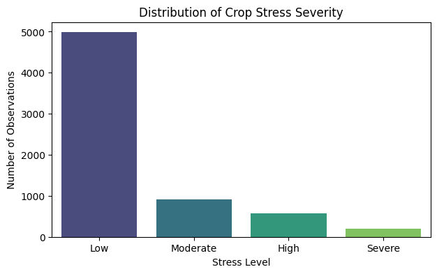
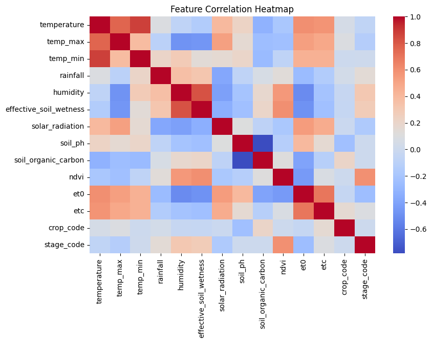
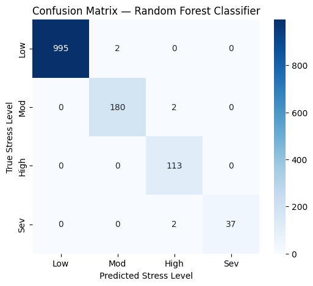
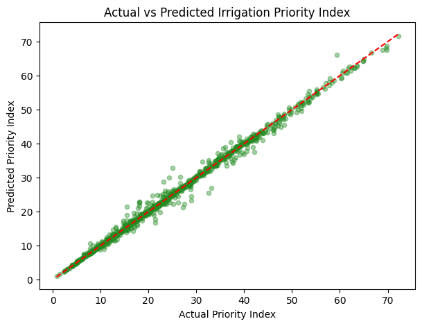
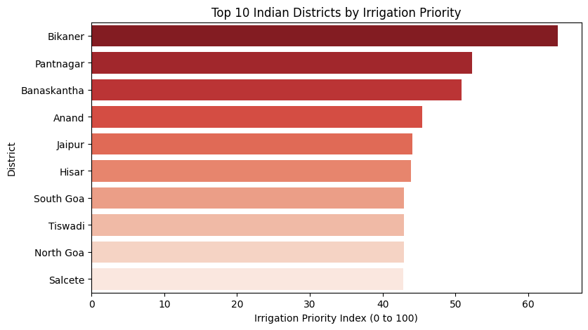
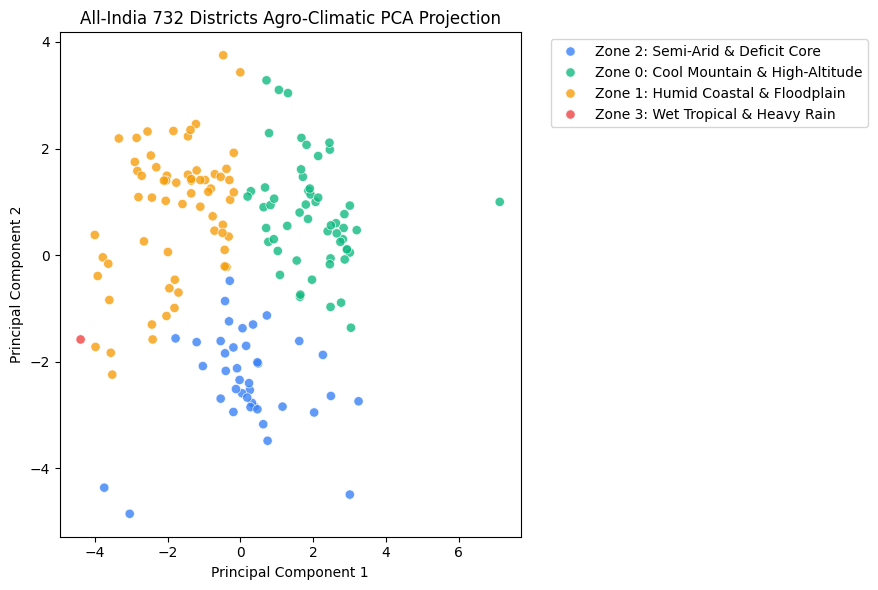

# KrishiJal — Complete Academic Project Explanation (KMIT Submission)

**Project Title:** Agricultural Intelligence & Crop Stress and Irrigation Priority Decision Support System (**KrishiJal**)  
**Target Audience:** B.Tech First-Year Academic Review & KMIT Faculty Evaluation  
**Source of Truth (ML Notebook):** [`notebooks/krishijal_complete_pipeline.ipynb`](../notebooks/krishijal_complete_pipeline.ipynb) (Kaggle Version 5)

---

## Table of Contents

1. [Project Overview & Objectives](#1-project-overview--objectives)
2. [Problem Statement](#2-problem-statement)
3. [Proposed Solution](#3-proposed-solution)
4. [Dataset Sources & Preparation](#4-dataset-sources--preparation)
5. [Machine Learning Algorithms Used](#5-machine-learning-algorithms-used)
6. [Model Training & Hyperparameter Tuning](#6-model-training--hyperparameter-tuning)
7. [Model Evaluation & Results](#7-model-evaluation--results)
8. [Backend Architecture (FastAPI)](#8-backend-architecture-fastapi)
9. [Frontend Architecture (6-Module Portal)](#9-frontend-architecture-6-module-portal)
10. [MySQL Integration & CRUD Operations](#10-mysql-integration--crud-operations)
11. [API Communication Flow](#11-api-communication-flow)
12. [Deployment Architecture](#12-deployment-architecture)
13. [How to Run the Project Locally](#13-how-to-run-the-project-locally)
14. [Quick Faculty Viva Q&A Summary](#14-quick-faculty-viva-qa-summary)

---

## 1. Project Overview & Objectives

**KrishiJal** is a full-stack machine learning and web application designed to help Indian farmers, agronomists, and irrigation officers make data-driven watering decisions. Instead of relying on guesswork or fixed calendar schedules, the system uses local temperature, rainfall, humidity, soil moisture, crop type, and crop growth stage to determine:
1. How stressed a crop currently is (`Low`, `Moderate`, `High`, or `Severe`).
2. How urgent irrigation is on a numerical scale from `0` to `100` (**Irrigation Priority Index**), along with the recommended irrigation water depth in millimeters.

### Core Objectives
- Unify satellite/meteorological weather indicators, crop evapotranspiration (`ET0`, `ETc`), and soil properties across India into one clean dataset.
- Train and compare multiple supervised ML algorithms for both classification and regression, keeping the best models serialized as `.pkl` files.
- Segment Indian districts into homogeneous **Agro-Climatic Zones** using unsupervised K-Means clustering and PCA visualization.
- Store real farmer profiles and live prediction records persistently in a normalized **MySQL** relational database with full Create, Read, Update, and Delete (CRUD) operations.
- Present all intelligence inside a single cohesive **6-module web portal** accessible anywhere via browser.

---

## 2. Problem Statement

Agriculture consumes the majority of freshwater resources in India, yet small and marginal farmers frequently face two costly extremes:
- **Under-irrigation (Delayed watering):** Leads to soil moisture exhaustion, wilting, severe crop stress, and irreversible yield loss.
- **Over-irrigation (Excess watering):** Wastes groundwater and electricity, leaches essential soil nutrients, and damages root aeration.

Generic weather apps report temperature or rain probability, not crop-specific water stress or irrigation volume recommendations, and government datasets are rarely connected to farmer-level decision logs.

---

## 3. Proposed Solution

KrishiJal bridges raw agro-climatic data and practical farm decisions through four connected layers:

1. **Data & ML Pipeline (Kaggle Notebook Version 5):** Preprocesses multi-source agricultural observations (`krishijal_master_dataset.csv`), standardizes 14 physical features, tunes Random Forest models with `GridSearchCV`, and exports trained `.pkl` models alongside verified evaluation metrics.
2. **Backend Decision Engine (`backend/main.py`):** Loads the saved `.pkl` models at startup, exposes REST endpoints through FastAPI, validates user inputs with Pydantic, computes agronomic advisories, and writes records to MySQL.
3. **MySQL Database Layer (`database/crop_stress_db.sql`):** Maintains normalized tables (`farmers`, `districts`, `crops`, `soil_info`, `irrigation_predictions`, `prediction_history`) with foreign keys so every farm prediction is auditable.
4. **6-Module Interactive Web Portal (`frontend/`):** Lets users inspect an all-India geospatial district map, run live interactive predictions, view ranked priority queues, review ML benchmarks, explore PCA cluster zones, and manage farmer records.

---

## 4. Dataset Sources & Preparation

### Master Dataset Overview
The processed dataset is stored at [`data/processed/krishijal_master_dataset.csv`](../data/processed/krishijal_master_dataset.csv):
- **Total Size:** **7,386 rows × 72 columns**
  - `daily`: **4,758 rows** (station-level daily agro-meteorological time series)
  - `monthly`: **1,896 rows** (monthly aggregates)
  - `district_baseline`: **732 rows** (district-level baselines across Indian States & UTs)
- **Crops Supported (10):** `Barley`, `Cotton`, `Groundnut`, `Maize`, `Mustard`, `Pulses`, `Rice`, `Soybean`, `Sugarcane`, `Wheat`
- **Growth Stages (4):** `Initial`, `Vegetative`, `Reproductive`, `Maturity`
- **Target Distribution (`stress_level` across full dataset):** Low (`5,243`), Moderate (`1,361`), High (`587`), Severe (`195`).

### Preparation Steps (Cells 5–13 of the Kaggle Notebook)
1. **Cleaning & Deduplication:** Removed missing core values (`temperature`, `rainfall`, `humidity`, `effective_soil_wetness`, `crop_type`, `growth_stage`) and checked duplicate records (`0` duplicates). Verified physical bounds such as `effective_soil_wetness` in `[0, 1]` and absence of uncleaned negative sensor anomalies.
2. **Modeling Subset Selection (`6,654` rows):** Filtered out static `district_baseline` summaries during model training so supervised models learn strictly from the **6,654 daily + monthly observations**.
3. **Label Encoding:** Encoded `crop_type` (`crop_code`) and `growth_stage` (`stage_code`) with `LabelEncoder`.
4. **14 Selected Input Features (`feature_cols`):**
   - **Weather & Temperature:** `temperature`, `temp_max`, `temp_min`, `rainfall`, `humidity`, `solar_radiation`
   - **Soil & Moisture:** `effective_soil_wetness`, `soil_ph`, `soil_organic_carbon`
   - **Crop & Evapotranspiration:** `ndvi` (Normalized Difference Vegetation Index), `et0` (Reference Evapotranspiration), `etc` (Crop Evapotranspiration), `crop_code`, `stage_code`
   *(Target-leakage columns such as `cwsi` and `water_deficit` were deliberately excluded from model training features.)*
5. **Stratified Train-Test Split (`80/20`):** Split the `6,654` records into **5,323 training samples** and **1,331 test samples** (`stratify=y_class`, `random_state=42`) to preserve class proportions in both sets.
6. **Feature Scaling:** Fitted `StandardScaler` on `X_train` only (to prevent data leakage) and saved it as `models/saved_models/feature_scaler.pkl`.

### Exploratory Data Figures (From Kaggle Version 5)

| Crop Stress Distribution | Feature Correlation Heatmap |
| :---: | :---: |
|  |  |

---

## 5. Machine Learning Algorithms Used

The system solves **three** distinct ML tasks:

### Task A — Multi-Class Classification (`stress_level_code`: `0=Low, 1=Moderate, 2=High, 3=Severe`)
1. **Logistic Regression (`max_iter=1000`):** Fast linear baseline modeling log-odds of each stress class.
2. **Decision Tree Classifier (`max_depth=8`):** Interpretable rule-based tree capturing non-linear thresholds (e.g., soil moisture vs temperature cutoffs).
3. **Random Forest Classifier (`n_estimators=100, max_depth=12`):** An ensemble of 100 decision trees trained on bootstrapped subsets; reduces overfitting and achieves the highest test accuracy (**99.55%**).

### Task B — Continuous Regression (`irrigation_priority_index`: `0–100`)
1. **Linear Regression (OLS):** Baseline weighted sum relating climate/soil features to irrigation priority.
2. **Decision Tree Regressor (`max_depth=8`):** Piecewise regression tree modeling non-linear moisture/heat stress interactions.
3. **Random Forest Regressor (`n_estimators=100, max_depth=12`):** Averages predictions across 100 trees, minimizing error (**MAE = 0.4538**, **R² = 0.9952**).

### Task C — Unsupervised Clustering & Dimensionality Reduction
1. **K-Means Clustering (`k=4, n_init=10, random_state=42`):** Groups districts using 10 normalized agro-climatic features (`temperature`, `rainfall`, `humidity`, `effective_soil_wetness`, `solar_radiation`, `soil_ph`, `soil_organic_carbon`, `ndvi`, `et0`, `etc`) into 4 distinct irrigation strategy belts.
2. **Principal Component Analysis — PCA (`n_components=2`):** Projects the 10-dimensional climate space onto 2 orthogonal axes (`PC1` and `PC2`) for visual inspection in the web dashboard and notebook.

---

## 6. Model Training & Hyperparameter Tuning

- **Environment:** Executed in Kaggle (`notebooks/krishijal_complete_pipeline.ipynb`, Version 5) with deterministic seeds (`random_state=42`).
- **GridSearchCV Tuning (Cell 20):**
  - Estimator: `RandomForestClassifier(random_state=42)`
  - Search Space: `n_estimators` in `[50, 100]`, `max_depth` in `[8, 12]`
  - Cross-Validation: **3-fold CV** (`cv=3`, `scoring="accuracy"`)
  - **Best Parameters Found:** `{'max_depth': 12, 'n_estimators': 100}`
- **Model Persistence (Cell 21):** All 7 fitted objects (`feature_scaler.pkl`, `crop_stress_classifier.pkl`, `irrigation_priority_regressor.pkl`, `crop_stress_decision_tree.pkl`, `crop_stress_logistic_regression.pkl`, `irrigation_decision_tree.pkl`, `irrigation_linear_regression.pkl`) were serialized cleanly using `joblib.dump(...)` and placed inside `models/saved_models/`.

---

## 7. Model Evaluation & Results

All metrics below are taken verbatim from the executed Kaggle Version 5 outputs (`1,331` held-out test records) and stored in `backend/model_evaluation_metrics.json`.

### Classification Comparison

| Model | Accuracy | Precision (Weighted) | Recall (Weighted) | F1-Score (Weighted) | Verdict |
| :--- | :---: | :---: | :---: | :---: | :--- |
| **Random Forest Classifier** | **99.55%** (`0.9955`) | **99.56%** (`0.9956`) | **99.55%** (`0.9955`) | **99.55%** (`0.9955`) | **Best Classifier** |
| **Decision Tree Classifier** | 99.47% (`0.9947`) | 99.48% (`0.9948`) | 99.47% (`0.9947`) | 99.47% (`0.9947`) | Highly Accurate |
| **Logistic Regression** | 96.02% (`0.9602`) | 96.06% (`0.9606`) | 96.02% (`0.9602`) | 96.03% (`0.9603`) | Linear Baseline |

#### Confusion Matrix Insight
Out of 1,331 test predictions by the tuned Random Forest Classifier (`99.55%` accuracy):
- **Low Stress:** 995 correct, 2 misclassified as Moderate
- **Moderate Stress:** 180 correct, 2 misclassified as High
- **High Stress:** 113/113 exact (100% recall on High class)
- **Severe Stress:** 37 correct, 2 misclassified as High
- Zero dangerous cross-extreme errors (`Low` is never confused with `Severe` or `High`).

### Regression Comparison

| Model | MAE | MSE | RMSE | R² Score | Verdict |
| :--- | :---: | :---: | :---: | :---: | :--- |
| **Random Forest Regressor** | **0.4538** | **0.9127** | **0.9554** | **0.9952** | **Best Regressor** |
| **Decision Tree Regressor** | 1.1975 | 4.0257 | 2.0064 | 0.9789 | Strong Non-Linear |
| **Linear Regression** | 4.8669 | 37.1909 | 6.0984 | 0.8055 | Linear Baseline |

### Verified Evaluation & Clustering Plots (Kaggle Version 5)

| Random Forest Confusion Matrix | Actual vs Predicted Priority Index |
| :---: | :---: |
|  |  |

| Top 10 High-Priority Districts | PCA 2D Agro-Climatic Clusters |
| :---: | :---: |
|  |  |

---

## 8. Backend Architecture (FastAPI)

The server entry point is [`backend/main.py`](../backend/main.py) (exposed at project root via `main.py` symlink and wrapped by [`run_local.py`](../run_local.py)):

1. **Startup Asset Loading:** Reads `data/processed/krishijal_master_dataset.csv`, loads `frontend/data/india_districts_simplified.geojson` and `portal_data.json`, loads all 7 `.pkl` models from `models/saved_models/`, and loads `backend/model_evaluation_metrics.json`.
2. **Precomputed District Ranking & Clustering:** Computes `KMeans(k=4)` and `PCA(n_components=2)` plus descending district irrigation priority rankings across the 732 districts for millisecond API responses.
3. **Request Validation (Pydantic):** Models like `PredictRequest`, `CropStressSimRequest`, `IrrigationPriorityRequest`, and `FarmerRequest` automatically reject invalid data types with HTTP `422 Unprocessable Entity` and fill optional hydrological indicators (`et0`, `etc`, `ndvi`, `solar_radiation`) via physics-based fallback formulas in `build_feature_row()`.
4. **Decision Rules Layer:** Translates the numerical priority index (`0–100`) into actionable categories (`Low Priority`, `Medium Priority`, `High Priority`, `Critical Priority`), water depth (`Routine / Nil`, `20–30 mm`, `35–45 mm`, `45–55 mm`), daily water deficit (`mm`), and human-readable advisories.
5. **Static Frontend Hosting:** Serves `frontend/` directly under `/app/` via `StaticFiles(..., html=True)` so only one port (`8000` locally, `$PORT` in production) serves both the UI and APIs cleanly without CORS headaches.

---

## 9. Frontend Architecture (6-Module Portal)

The user interface is a responsive Single Page Application built with pure HTML5, CSS3, ES6 JavaScript, and **Leaflet.js**:
- [`frontend/index.html`](../frontend/index.html): Defines the Home dashboard plus all 6 module views routed via clean URL hash paths.
- [`frontend/portal.css`](../frontend/portal.css): Unified agricultural color tokens, responsive grid layouts (desktop/tablet/mobile), dark/light map theme support, and card/button hover animations.
- [`frontend/portal.js`](../frontend/portal.js): Hash router (`route()`), dynamic 6-module quick switcher (`initModuleDocks()`), Leaflet map layer/choropleth renderer, rotary dial predictor controls, sortable/searchable tables, PCA SVG scatter tooltip viewer, and MySQL CRUD handlers.

### Consistent 6 Modules Everywhere
All 6 modules stay accessible on the top navigation bar, the Hero shortcut buttons, the Home thumbnail cards, and the in-view bottom/top `.module-dock` quick-bar:
1. **Geospatial Map** (`#/map`)
2. **Predictor** (`#/predictor`)
3. **Irrigation Priority** (`#/ranking`)
4. **ML Benchmarks** (`#/benchmarks`)
5. **Agro-Climatic Clusters** (`#/clusters`)
6. **Farmer Records** (`#/farmers`)

---

## 10. MySQL Integration & CRUD Operations

The database schema in [`database/crop_stress_db.sql`](../database/crop_stress_db.sql) defines **6 relational tables** inside `crop_stress_db`:

| Table | Purpose | Primary / Foreign Keys |
| :--- | :--- | :--- |
| `farmers` | Farmer directory (name, phone, village, state, district, primary crop, soil type, acres) | `PK: farmer_id` |
| `districts` | District lookup & climate averages | `PK: district_id`, unique `(state_name, district_name)` |
| `crops` | Crop + growth stage normalization lookup | `PK: crop_id`, unique `(crop_name, growth_stage)` |
| `soil_info` | Recorded field soil moisture, pH & organic carbon | `PK: soil_id`, `FK: district_id` |
| `irrigation_predictions` | Full weather/soil inputs, predicted stress, priority, depth, deficit & advisory | `PK: prediction_id`, `FK: farmer_id, district_id, crop_id, soil_id` |
| `prediction_history` | Timeline log of farmer advisories linked to each prediction | `PK: history_id`, `FK: prediction_id, farmer_id` |

### CRUD Operations Implemented
- **Create:** `POST /api/farmers` adds a farmer profile; `POST /predict` automatically creates or links `districts`, `crops`, `soil_info`, optional `farmers`, `irrigation_predictions`, and `prediction_history`.
- **Read:** `GET /api/farmers` (with search filter and prediction counts) & `GET /api/predictions/history` (joined query across 5 tables).
- **Update:** `PUT /api/farmers/{farmer_id}` updates farmer details safely inside parameterized SQL queries.
- **Delete:** `DELETE /api/farmers/{farmer_id}` and `DELETE /api/predictions/{prediction_id}` cleanly cascade-delete dependent logs (`ON DELETE CASCADE`).

*Security:* Credentials are read dynamically from `.env` via `python-dotenv` (`os.getenv(...)`) and **never** hardcoded or committed to Git. Parameterized queries (`%s` placeholders) prevent SQL injection.

---

## 11. API Communication

When a farmer or reviewer interacts with the UI (`frontend/portal.js`), `fetch()` communicates with FastAPI JSON endpoints:

| Method | Endpoint | Purpose |
| :--- | :--- | :--- |
| `GET` | `/health` | Verifies API and loaded `.pkl` models |
| `GET` | `/api/db/health` | Checks MySQL connection and row counts |
| `POST` | `/predict` | Runs 14-feature ML inference & saves history to MySQL |
| `POST` | `/api/predict/crop-stress` | Runs interactive stress simulation across selectable algorithms |
| `POST` | `/api/predict/irrigation-priority` | Computes continuous irrigation priority index |
| `GET` | `/api/dataset/info` | National dataset summary averages & stress counts |
| `GET` | `/api/district-profile` | Fetches climate, soil & crop profile for one district |
| `GET` | `/api/districts/all` | Returns all 732 district baseline records |
| `GET` | `/api/coverage-report` | State-by-state boundary and feature coverage summary |
| `GET` | `/api/irrigation/priority` | Ranked descending irrigation priority queue |
| `GET` | `/api/clusters/regions` | K-Means (`k=4`) zones + PCA variance & coordinates |
| `GET` | `/api/models/evaluation` | Served metrics from Kaggle Version 5 JSON |
| `GET/POST/PUT/DELETE` | `/api/farmers` (`/{farmer_id}`) | Farmer Records CRUD operations |
| `GET/DELETE` | `/api/predictions/history` (`/{prediction_id}`) | Prediction audit log retrieval & cleanup |

---

## 12. Deployment Architecture

```text
+---------------------------------------------------------------+
|                User Browser (Desktop / Mobile)                |
|   Leaflet Map | Predictor | Ranking | Benchmarks | Clusters   |
|                      Farmer Records UI                        |
+------------------------------+--------------------------------+
                               | HTTPS / REST JSON
                               v
+---------------------------------------------------------------+
|        Render Web Service / Local Uvicorn (Port 8000)         |
|   FastAPI (`backend/main.py` via root `main.py` symlink)      |
|   - Serves static SPA under `/app/`                           |
|   - Loads 7 `.pkl` models (`StandardScaler`, RF, DT, LR)      |
|   - Reads `model_evaluation_metrics.json` & GeoJSON/CSV data  |
+------------------------------+--------------------------------+
                               | mysql-connector-python (.env)
                               v
+---------------------------------------------------------------+
|                  MySQL 8.0 (`crop_stress_db`)                 |
|  farmers | districts | crops | soil_info | predictions | log  |
+---------------------------------------------------------------+
```

- **Local Mode:** Run `python3 run_local.py` with local MySQL on `127.0.0.1:3306`.
- **Cloud Production (`render.yaml`):** Installs runtime packages from `requirements.txt`, starts `uvicorn main:app --host 0.0.0.0 --port $PORT`, and monitors `/health`.

---

## 13. How to Run the Project Locally

1. **Install Python dependencies:**
   ```bash
   pip install -r requirements.txt
   ```
2. **Initialize MySQL database & `.env`:**
   ```bash
   mysql -u root -p < database/crop_stress_db.sql
   cp .env.example .env
   # Edit .env and add your MySQL password
   ```
3. **Start the application:**
   ```bash
   python3 run_local.py
   ```
4. **Open in Browser:** Visit `http://127.0.0.1:8000/app/`
5. **Run Automated Verification Tests:**
   ```bash
   python3 tests/test_project.py
   ```

---

## 14. Quick Faculty Viva Q&A Summary

- **Why Random Forest over Logistic Regression / Decision Tree?**  
  Weather, soil wetness, and evapotranspiration interact non-linearly. A single Decision Tree captures non-linear thresholds (`99.47%`), while Random Forest combines 100 tuned trees (`max_depth=12`) to stabilize predictions and achieve **99.55% classification accuracy** and **0.9952 R²** in regression.
- **How do you prevent target leakage in ML evaluation?**  
  Derived target indicators (`cwsi`, `water_deficit`) are excluded from the 14 input features used during model training, `StandardScaler` is fit strictly on the 5,323 training samples, and evaluation runs on the unseen 1,331 stratified test set.
- **How are the 4 Agro-Climatic Clusters computed?**  
  Using unsupervised **K-Means (`k=4`)** over 10 standardized climate/soil variables and projected into 2 dimensions via **PCA** (`n_components=2`) for plotting.
- **What happens if MySQL is temporarily disconnected?**  
  All ML predictions, geospatial maps, clusters, and benchmarks continue working cleanly via `.pkl` models and static dataset files, while `/api/db/health` safely reports database connection status without crashing the server.
